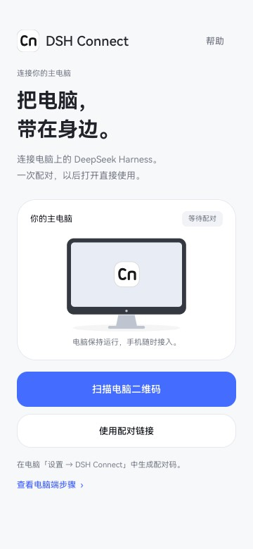
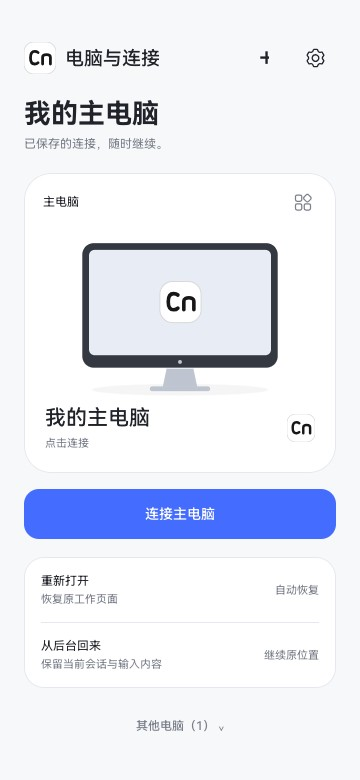
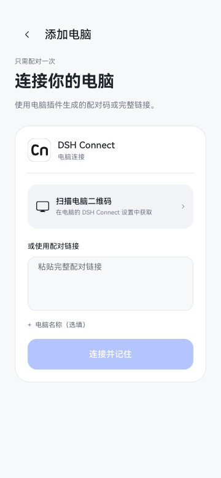

<p align="center"><picture><source media="(prefers-color-scheme: dark)" srcset="branding/cn-mark-dark.svg"></picture></p>
<h1 align="center">DSH Connect</h1>
<p align="center">把电脑上的 DeepSeek Harness，带在身边。</p>

DSH Connect 让你通过鸿蒙应用或浏览器，继续使用电脑上的完整 DeepSeek Harness：会话、工作区、文件、模型、工具与任务共用同一份数据。模型调用和工具执行由连接的电脑完成。

**当前版本：1.0.1。** 鸿蒙应用与电脑插件统一命名为 **DSH Connect**，插件包名为 `dsh-connect`。

## 选择打开方式

| 方式 | 适合的使用习惯 | 入口 |
| --- | --- | --- |
| 鸿蒙应用 | 记住多台电脑、扫码连接、使用系统相机／相册／文件入口 | [鸿蒙应用说明](harmony/README.md) |
| 浏览器 | 打开链接即可使用，适合不想安装应用的设备 | [电脑插件说明](desktop-plugin/README.md) |

连接后的完整工作区由电脑上的 DSH 提供。应用首页和连接管理使用 ArkUI；会话区由 ArkWeb 承载。浏览器入口保留相同的移动排版和连接恢复能力。

## 页面

<p align="center"></p>

页面来自官方 SDK 的原生渲染，使用演示电脑数据。[下载完整页面图册](https://github.com/LUMIAO9527/DSH-Connect/releases/download/v1.0.1/DSH-Connect-1.0.1-preview.html)。

## 下载

从 [Releases](https://github.com/LUMIAO9527/DSH-Connect/releases/latest) 获取：

- `dsh-connect-1.0.1.tgz`：安装在电脑 DSH 中的插件。
- `DSH-Connect-1.0.1-unsigned.hap`：鸿蒙应用的未签名 release 构建，需要配置自己的开发签名后安装。
- `DSH-Connect-1.0.1.zip`：完整源码、说明及本版安装产物。
- `DSH-Connect-1.0.1-icon-light.svg`／`DSH-Connect-1.0.1-icon-dark.svg`：浅、深两套 Cn 矢量图标。
- `SHA256SUMS.txt`：文件校验和。

HAP 目前需要 DevEco 开发签名，尚未提供应用市场的通用安装包。首次体验也可以先使用浏览器入口。

## 开始使用

1. 在电脑上打开 DeepSeek Harness，安装 `dsh-connect-1.0.1.tgz`，启用 **DSH Connect** 插件。
2. 为电脑配置固定 HTTPS 访问入口，将 HTTP 和 WebSocket 转发到插件的本机网关；在插件配置中填写这个地址。
3. 打开电脑的「设置 → DSH Connect」，生成配对二维码或链接。
4. 用鸿蒙应用扫描二维码或粘贴链接；浏览器直接打开完整链接。应用和每个浏览器分别完成一次配对。
5. 配对后保存固定入口。以后打开应用或原来配对的浏览器即可继续工作。

电脑、DSH、HTTPS 通道和网络需要保持可达。连接方式、配置字段和更新步骤见 [电脑插件 README](desktop-plugin/README.md)。

## 主要体验

- 主电脑集中展示，其他电脑按需展开；支持重命名和移除。
- 冷启动恢复最近使用的电脑和原工作页面；从后台回来保留当前会话和草稿。自动恢复可在设置中关闭。
- 手机使用纵向布局、会话抽屉和设置二级页面；输入框及字号适应窄屏。
- 应用统一处理系统安全区与键盘；输入框下方保留 Token／上下文信息，上方保留排队消息与扩展位置。
- Cn 图标与 Nx、Rm 共用圆角底板和圆润笔画；深色黑底白字、浅色白底黑字，同步用于启动页、电脑封面和网页入口。

## 升级与数据

更新时保留原固定地址、端口和设备状态目录。已有的浏览器 Cookie 和设备授权继续使用；新插件会优先使用自己的已有状态，并在旧版默认状态存在时原地复用。采用自定义状态目录的安装继续填写原路径。

旧连接器需要先停用，再启用新版，避免两个网关占用同一端口。旧预览包与历史提交仍保留在 GitHub；1.0.0 是采用 DSH Connect 统一名称的首个正式版本。不会自动重放消息、审批或其他写请求。

## 开发与验证

```powershell
npm ci --ignore-scripts
npm run check
npm test
./branding/Build-Brand.ps1 -Check
./Build-Release.ps1 -ToolsRoot <已有官方HarmonyOS工具链目录> -JavaHome <已有Java目录>
```

源码结构：`harmony/` 为鸿蒙客户端，`desktop-plugin/` 为电脑插件，`branding/` 为 Cn 图形源及派生资源生成脚本，`tools/` 为发布检查。根目录的 npm 入口指向同一个电脑插件，便于从仓库安装；Release TGZ 是推荐的固定版本入口。

验证基线、已运行检查和待验收项目见 [验证记录](docs/VALIDATION.md)。未签名 HAP、SDK 页面预览和真机测试分别记录。原生文件全流程、长时间锁屏和切网需要在具体设备上验收。

## 许可与来源

本项目采用 [Apache-2.0](LICENSE)。部分连接与认证代码改编自 `dsh-mobile 0.6.18`，保留上游声明与许可证，见 [第三方说明](desktop-plugin/lib/mobile-access/NOTICE)。轻量鸿蒙外壳的思路参考 [SakuraNeko/Deepseek-Harmony](https://github.com/SakuraNeko/Deepseek-Harmony)。
