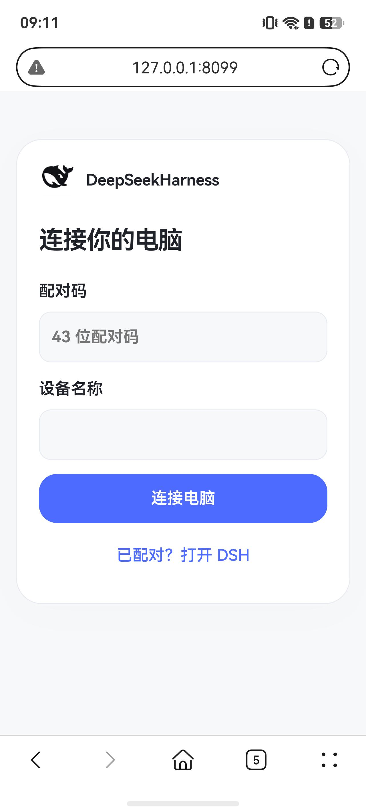

<p align="center"></p>
<h1 align="center">DSH Connect</h1>
<p align="center">把电脑上的 DeepSeek Harness，带在身边。</p>

<p align="center">
  <a href="https://github.com/LUMIAO9527/DSH-Connect/releases/latest"></a>
  <a href="LICENSE"></a>
  
</p>

用手机浏览器继续使用电脑上的完整 DeepSeek Harness：会话、工作区、文件、模型、工具与任务共用同一份数据。模型调用和工具执行在电脑上完成，手机只负责显示和操作。

插件包名为 `dsh-connect`，只提供浏览器入口。

## 界面

<p align="center">
  
  
</p>

白底启动画面后直接进入工作区；配对一次，之后打开链接即可恢复。

## 打开方式

在手机浏览器打开电脑给出的链接，无需安装应用。工作区由电脑上的 DSH 提供，手机使用 Harness 自带的会话栏、侧栏和页签；插件负责移动排版、配对、连接恢复和传输。一个浏览器记住一台电脑，多台电脑就是多个链接。

## 两种链接

| 类型 | 用途 | 有效期 |
| --- | --- | --- |
| 永久链接 | 日常入口，存为书签或添加到主屏幕 | 长期 |
| 临时链接 | 发给别人临时使用 | 10 分钟，只能使用一次 |

永久链接里点「配对链接」生成一次性配对链接和二维码，新设备完成授权后即可长期使用。

## 下载

从 [Releases](https://github.com/LUMIAO9527/DSH-Connect/releases/latest) 获取：

- `dsh-connect-版本.tgz`：安装在电脑 DSH 中的插件。
- `DSH-Connect-版本-source.zip`：完整源码与构建脚本。
- `DSH-Connect-版本-icon.svg`：Cn 矢量图标。
- `SHA256SUMS.txt`：文件校验和。

## 连接方式

同一局域网内，插件自动选择可用的局域网地址并提供二维码，扫码完成配对并校验电脑身份。跨网使用内置 HTTPS 中继或固定 HTTPS 入口；中继部署见 [电脑插件 README](desktop-plugin/README.md)。

## 主要体验

- 手机使用紧凑的标题和页签、会话抽屉与分组设置；文件夹在手机内浏览电脑文件，「＋」直接选择附件。
- 保留 Token／上下文信息与排队消息；连接、错误和其他对话的待处理统一用全局通知。
- 切网或回到前台自动恢复连接；文字流中断时读取快照，发送结果按原回执核对。
- 连接状态可点开查看当前传输路径、设备名和地址。

[首次使用、更新与卸载](docs/LIFECYCLE.md)

## 升级

在「设置 → DSH Connect → 版本更新」检查并安装。更新保留固定地址、端口和设备状态，已有浏览器授权继续有效；安装失败会恢复上一版。

## 开发

```powershell
npm ci --ignore-scripts
npm run check
npm test
./branding/Build-Brand.ps1 -Check
./Build-Release.ps1
```

`desktop-plugin/` 为电脑插件与浏览器入口，`branding/` 为图形资源，`tools/` 为发布检查；Release TGZ 是推荐的安装入口。

验证与变更见 [验证记录](docs/VALIDATION.md) 和 [更新日志](CHANGELOG.md)。

## 许可与来源

本项目采用 [Apache-2.0](LICENSE)。部分连接与认证代码改编自 `dsh-mobile 0.6.18`，保留上游声明与许可证，见 [第三方说明](desktop-plugin/lib/mobile-access/NOTICE)。